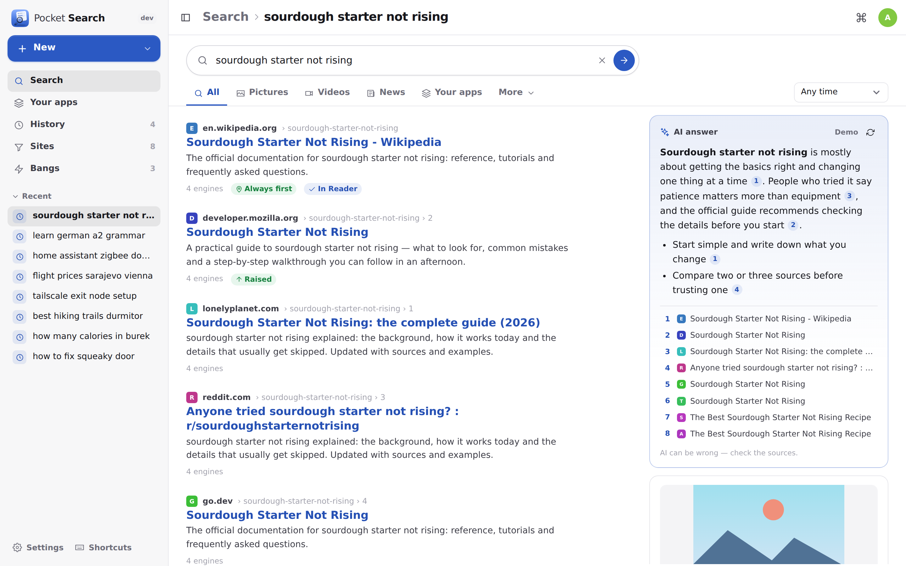
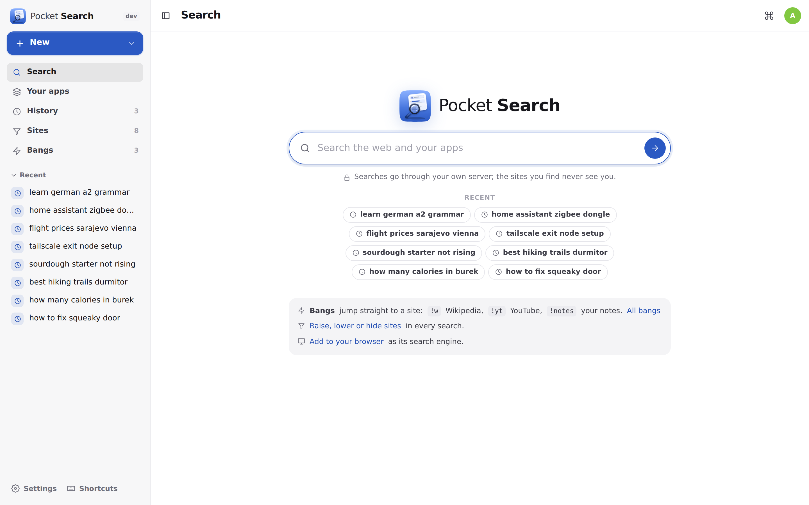
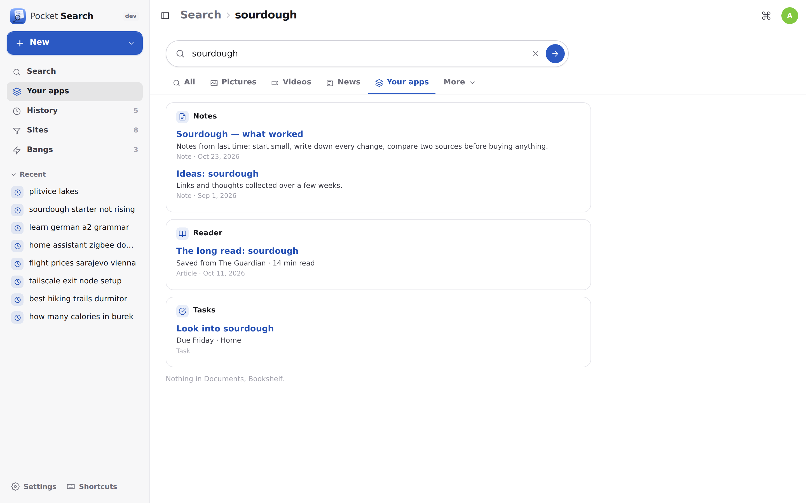
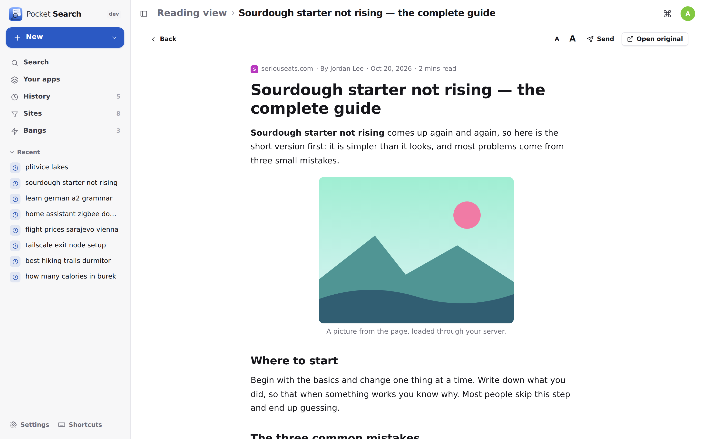
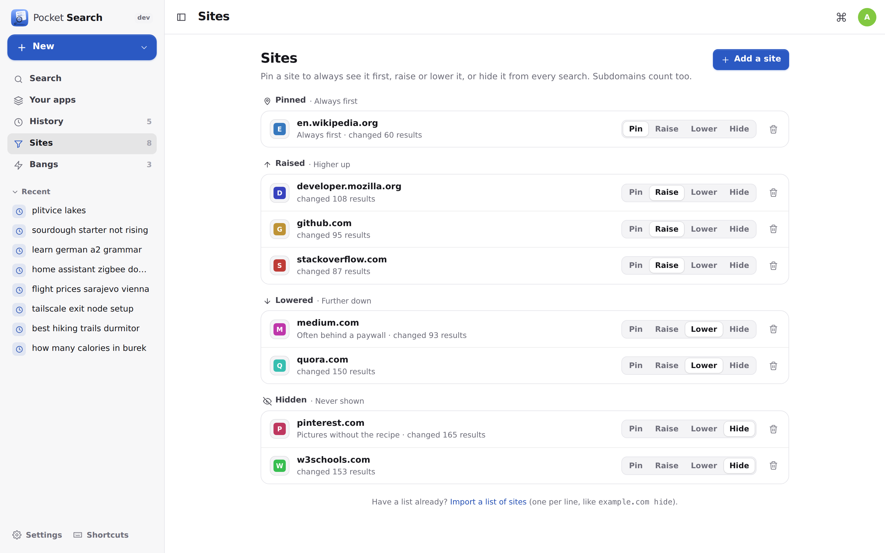
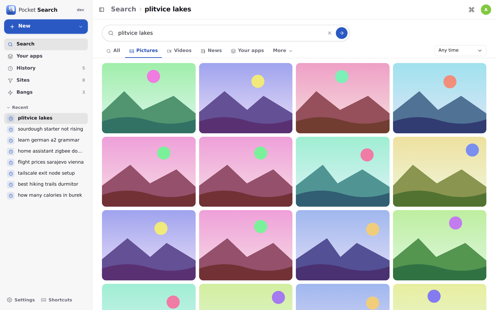
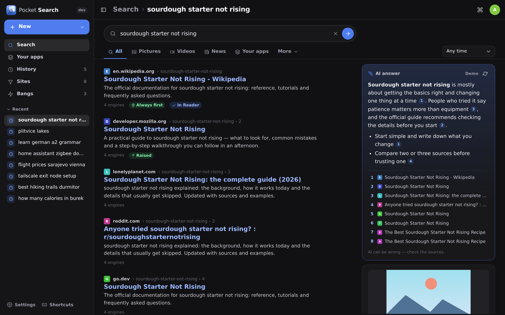
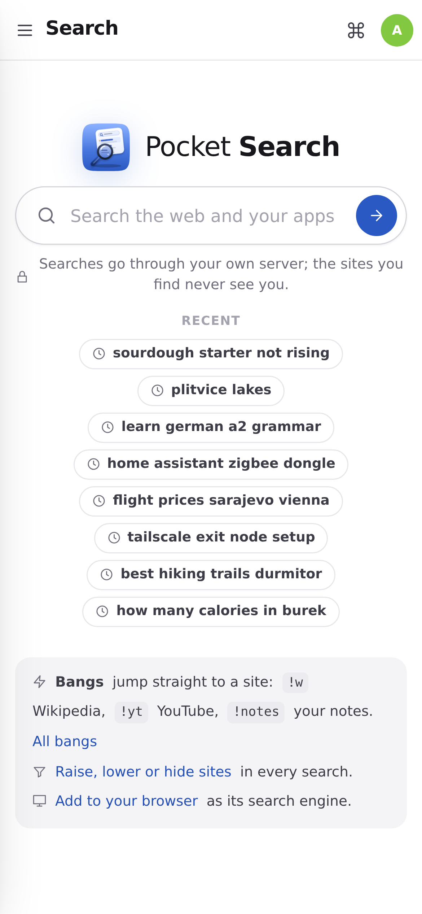
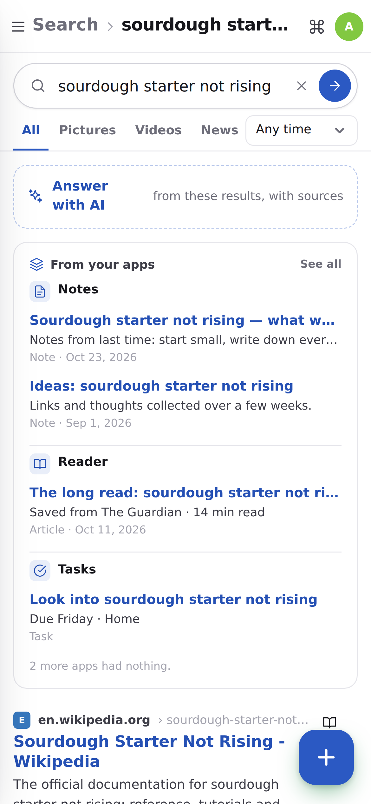
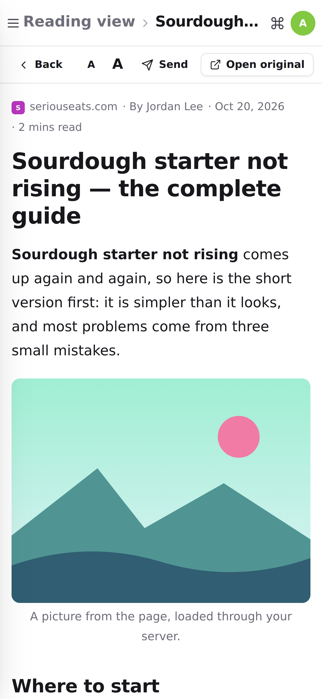

<p align="center"></p>
<h1 align="center">Pocket Search</h1>
<p align="center">Private web search through your own server. A bundled SearXNG asks Google, Bing, Brave, DuckDuckGo, Wikipedia and ~70 other engines at once, your Pocket apps are searched beside the web, and you decide which sites come first, sink or never show up. Bangs jump straight to a site, a reading view opens pages without trackers, an AI answer cites its sources, and one tap sends a result to Reader, Notes, Tasks, Lookout or Wishlist.<br>One Go binary, one SQLite file, one volume. Part of the Pocket apps; works on its own too.</p>
<p align="center">
  <a href="https://github.com/abjelosevic88/pocket-homelab-search/actions"></a>
  <a href="https://github.com/abjelosevic88/pocket-homelab-search/pkgs/container/pocket-homelab-search"></a>
  <a href="LICENSE"></a>
</p>

---

<p align="center"></p>

<table>
  <tr>
    <td width="50%"></td>
    <td width="50%"></td>
  </tr>
  <tr>
    <td align="center"><sub>One box for the web and your own apps.</sub></td>
    <td align="center"><sub>Notes, Reader, Tasks, Documents, Mail… searched at the same time.</sub></td>
  </tr>
  <tr>
    <td width="50%"></td>
    <td width="50%"></td>
  </tr>
  <tr>
    <td align="center"><sub>The reading view: your server fetches the page, scripts and trackers stay out.</sub></td>
    <td align="center"><sub>Pin, raise, lower or hide any site in every search.</sub></td>
  </tr>
  <tr>
    <td width="50%"></td>
    <td width="50%"></td>
  </tr>
  <tr>
    <td align="center"><sub>Pictures, videos and news — thumbnails load through your server too.</sub></td>
    <td align="center"><sub>Light and dark follow the system.</sub></td>
  </tr>
</table>

<p align="center">
  &nbsp;&nbsp;
  &nbsp;&nbsp;
  
</p>

## What it does

- **Private by design** — searches go from your server to the engines; pictures, thumbnails and site icons are fetched by the server, and pages open without a referrer, so sites never learn what you searched for or who you are.
- **Its own engine** — `docker compose up` starts the app and SearXNG together. The engine has no port of its own and no settings file to edit; engines are switched on and off per person in Settings.
- **Your apps in the results** — your notes, saved articles, tasks, documents, calendar, contacts, mail, issues, cards, books, tabs, drawings, trips… searched at the same time as the web (with Pocket Core, nothing to paste). `!notes groceries` searches one app.
- **Your ranking** — pin a site to the top, raise or lower it, or hide it everywhere (Pinterest, content farms). Each rule counts the results it changed.
- **Bangs** — `!w eiffel tower`, `!yt`, `!gh`, `!m`… about 60 built in, plus your own. They work from the browser's address bar too, before the page even loads.
- **Reading view** — open any result as clean text with pictures through your server; left-out players are counted.
- **AI answers** — a short answer above the results with every claim numbered to its source; it can read the top three pages. Pocket AI through Pocket Core, or your own OpenAI-compatible key. Off, on a button, or automatic.
- **Send a result** — read later in Pocket Reader, keep it as a note, add a task, watch it with Pocket Lookout, add it to your Pocket Wishlist. The result shows where it went.
- **History you control** — per person, pausable, cleared by the hour, day, week or all; forgotten after 90 days unless you choose otherwise.
- **Everywhere** — add it as your browser's search engine (OpenSearch), install it on a phone's home screen, put it in Homepage's quick launch.

## Run it

```sh
curl -O https://raw.githubusercontent.com/abjelosevic88/pocket-homelab-search/main/docker-compose.yml
docker compose up -d        # the app on :8080 and its engine
```

Or the binary alone with your own SearXNG (`search.formats: [html, json]` in its settings):

```sh
SEARXNG_URL=http://searxng:8080 BASE_URL=https://search.example.com SECURE_COOKIES=true ./pocket-search
```

Try it without anything: `DEMO_DATA=true AUTH_MODE=none ./pocket-search` answers with made-up results.

## With Pocket Core

Set `CORE_URL` and `CORE_REGISTRATION_KEY` and Search joins the box: people sign in with Pocket Core, your Pocket apps are searched and results sent to them through Core links (each one off until you switch it on, per person), and AI answers use Pocket AI. Other apps can search the web for you through Search (`search:read`), and Pocket Core's AI tools `pocket_search_web` / `pocket_search_read_page` give Pocket AI and your assistants private web search. Without Core everything works with direct app tokens and your own OpenAI key; the Core-only choices stay visible, greyed out.

## Docs

[Configuration](docs/configuration.md) · [API](docs/api.md) · [Backup](docs/backup.md) · [Reverse proxy](docs/reverse-proxy.md)

## Build

```sh
make web build   # UI into web/dist, then the binary
make run         # demo data, no login
make test        # go vet + go test + tsc
```

MIT © 2026 Aleksandar Bjelosevic
